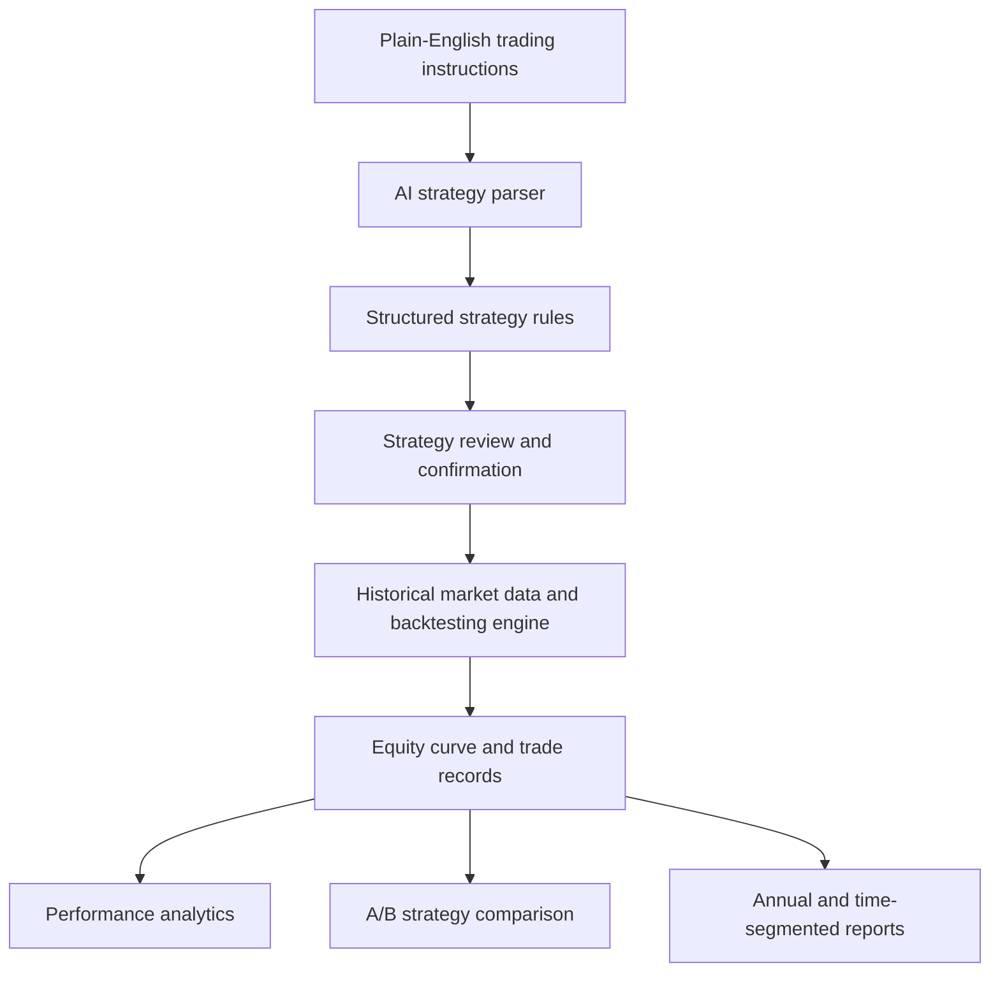

<div align="center">

# 📈 US Stock Strategy Lab

### AI-Powered U.S. Equity Strategy Backtesting

**Describe a trading strategy in plain English. Turn it into rules. Backtest it. Compare the results.**

[**🚀 Try the Live Application**](https://ian11295168-blip-usstockbacktestbot-secure-app-erimot.streamlit.app/) · [**Explore the Features**](#key-features) · [**How It Works**](#how-it-works)

   

**Public guest access · No account required**

</div>

---

## Overview

**US Stock Strategy Lab** is an independently developed, cloud-hosted application for exploring rule-based trading strategies on U.S. stocks. It connects natural-language strategy interpretation with historical backtesting and interactive performance analysis.

Instead of requiring users to write trading code, the application lets them describe entry and exit conditions, review the parsed rules, and run a simulation with transparent performance metrics.

> **Try it:** [Launch the live app](https://ian11295168-blip-usstockbacktestbot-secure-app-erimot.streamlit.app/) and use the **Guest Workspace**. The guest workspace uses the application's AI parsing and backtesting functionality without access to the owner's private strategy records.

## Key Features

| Feature | What it does |
| --- | --- |
| **Natural-language strategy parsing** | Uses the OpenAI API to interpret trading instructions and produce structured strategy rules for review. |
| **Historical backtesting** | Simulates entry, exit, stop-loss, and take-profit conditions using historical U.S. equity data. |
| **Technical indicators** | Supports rules involving indicators such as RSI, moving averages, EMA, MACD, and Bollinger Bands. |
| **A/B strategy comparison** | Runs two strategy configurations and compares performance metrics and equity curves. |
| **Performance analytics** | Reports total return, CAGR, Sharpe ratio, maximum drawdown, win rate, and a buy-and-hold benchmark. |
| **Detailed reports** | Provides annual performance, trade history, CSV export, and time-segmented analysis. |
| **Cloud deployment** | Runs on Streamlit Community Cloud, with a separate owner workspace for private cloud records. |

## Try a Strategy

Copy this example into the **Guest Workspace** and select **Create New Strategy**:

```text
Create a new trading strategy for AAPL.
Buy when RSI(14) is below 30.
Sell when RSI(14) is above 70.
Set a fixed stop loss of 7% and a take profit of 15%.
Backtest the past 5 years.
```

1. Select **Parse Strategy with AI**.
2. Review the proposed entry, exit, and risk-management rules.
3. Select **Confirm & Run Backtest**.
4. Review the equity curve, performance metrics, and trade details.
5. Modify the strategy to compare alternatives using **A/B Comparison**.

> The AI parser may require clarification for ambiguous instructions. Always review the generated rules before running a backtest.

## How It Works



### Technical Architecture

- **Frontend:** Streamlit interactive web interface.
- **Strategy interpretation:** OpenAI API integrated with rule validation and strategy summaries.
- **Computation:** Python, pandas, and NumPy for technical indicators, backtesting, and performance analysis.
- **Owner storage:** Supabase PostgreSQL for private strategies and saved results.
- **Public guest workspace:** Session-scoped strategies and results, isolated from owner records.
- **Additional interface:** Telegram bot integration and private Telegram strategy-history views.

## Project Structure

```text
USStockBacktestBot/
├── secure_app.py             # Guest and owner navigation
├── web_app.py                # Interactive Streamlit application
├── universal_ai_parser.py    # Natural-language strategy parsing
├── universal_backtest.py     # Historical backtesting engine
├── indicator_engine.py       # Technical indicator calculations
├── strategy_ab_comparison.py # A/B evaluation
├── performance_metrics.py    # Risk and return measures
├── yearly_performance.py     # Annual performance reports
├── out_of_sample.py          # Time-segmented analysis
├── cloud_web_storage.py      # Private cloud persistence
└── requirements.txt          # Python dependencies
```

## Methodology & Limitations

- Backtests are **historical simulations**, not forecasts or investment recommendations. Actual results may differ because of market conditions, liquidity, transaction costs, and execution.
- Reported returns depend on the selected strategy, period, market data, and simulation assumptions.
- **Time-segmented analysis** divides an existing backtest into earlier and later periods; it is **not automatically an independent out-of-sample validation**. Such a claim requires developing the strategy without using later-period information.
- Public guest work is session-based and is not saved to the owner's private database. Guest AI requests are subject to usage limits and service availability.

## Why I Built This

I built this project to connect quantitative reasoning with a practical tool for evaluating investment ideas. Developing the application involved translating ambiguous strategy descriptions into explicit rules, implementing a reproducible backtesting workflow, and designing a user interface that makes the results easier to inspect and compare.

The project reflects my interests in **applied mathematics, data analytics, financial technology, and AI-enabled software development**.

---

<div align="center">

### Explore the Working Application

[**🚀 Launch US Stock Strategy Lab**](https://ian11295168-blip-usstockbacktestbot-secure-app-erimot.streamlit.app/)

*For educational and research demonstration purposes only. Not investment advice.*

</div>
